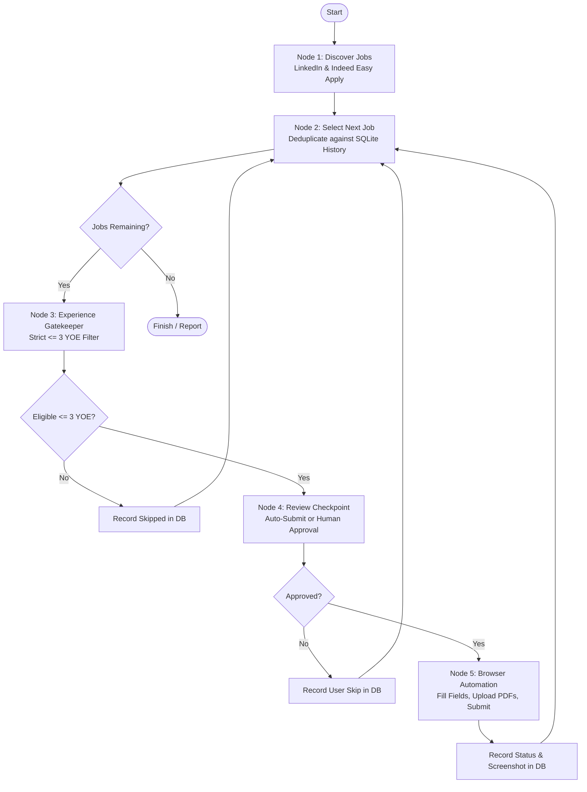

# Autonomous Job Discovery & Application Agent (LangGraph + Playwright)

An autonomous, agentic job search and application engine built with **LangGraph** and **Playwright**. It discovers live **Easy Apply** / **Direct Apply** software engineering positions on **LinkedIn** and **Indeed**, strictly filters for roles requiring **$\le 3$ years of experience**, autofills application forms using a localized RAG engine over the candidate's resume and structured profile, attaches static documents (resume and cover letter), and submits applications with audit proof.

---

## Key Features

- **Multi-Platform Discovery**: Simultaneously scrapes live, active Easy Apply (LinkedIn) and Direct Apply (Indeed) roles using `python-jobspy` configured for target regions (e.g., India).
- **Strict Experience Gatekeeper ($\le 3$ YOE)**: Regex and semantic parser inspects job titles and descriptions to reject senior/lead roles (4+ YOE, Staff, Principal, Lead) while admitting entry-level, fresher, associate, and $\le 3$ YOE ranges.
- **Form-Filling RAG Engine**: Accurately maps application form questions to structured candidate context:
  - **Company & Role**: Autocompletes current organization (*Avalara Technologies*) and designation (*Software Engineer*).
  - **Experience & Notice Period**: Strict candidate rules (e.g., technology experience $\rightarrow$ `2`, notice period $\rightarrow$ `0` days).
  - **Clean CTC Formatting**: Pure numeric values without currency text (e.g. `1500000` / `1800000`, or `15` / `18` if LPA is requested).
  - **Rate Yourself Questions**: Automatically selects the highest rating integer (`5` on 1–5 scale, `10` on 1–10 scale, or "Expert").
  - **Previous Employer Check**: Always selects `No` for questions asking if you previously worked at the hiring organization.
  - **Consent & Declarations**: Automatically agrees/consents (`Yes`) to terms, declarations, and data processing.
- **Browser Automation (Playwright + Stealth Chrome)**:
  - Runs in real Google Chrome using a persistent profile (`browser_profile/`) to preserve authenticated LinkedIn and Indeed sessions without triggering bot detection or CAPTCHAs.
  - **Anti-Flicker & Smooth Filling**: Form inputs are focused and filled atomically with event dispatching without viewport jumping or focus fighting.
  - **Dropdown & Combobox Support**: Handles standard `<select>` as well as modern custom comboboxes (`input[role="combobox"]`, `div.fb-dropdown`, `button[aria-haspopup="listbox"]`).
  - **Cover Letter & Resume Upload**: Detects optional "Add cover letter" triggers and uploads `coverLetter.pdf` and `Resume.pdf` to their respective inputs.
  - **Company Follow Opt-Out**: Automatically unchecks the LinkedIn *"Follow company to stay up to date"* checkbox before submitting.
- **Queue Deduplication & SQLite Audit**:
  - Normalizes platform job keys (`linkedin_<id>`, `indeed_<jk>`) and prevents duplicate attempts for submitted, already-applied, or skipped roles.
  - Every application attempt captures a timestamped screenshot saved to `logs/screenshots/`.
- **Human-in-the-Loop or Fully Autonomous Modes**: Support for interactive review (`--review`) before submission or hands-off auto-submit (`--auto`).

---

## Architecture Workflow



---

## Project Structure

```
c:\langgraph\
├── data/
│   ├── profile.example.yaml        # Template for candidate profile
│   ├── profile.yaml                # Candidate profile (local, git-ignored)
│   ├── Bhakti_Deshmukh_Resume.pdf  # Static resume (local, git-ignored)
│   └── coverLetter.pdf             # Static cover letter (local, git-ignored)
├── src/
│   ├── config.py                   # Central paths, environment vars & profile loaders
│   ├── state.py                    # LangGraph ApplicationState schema (TypedDict)
│   ├── rag_engine.py               # Candidate context & form question answer engine
│   ├── job_filter.py               # Job scraping (jobspy) & <= 3 YOE experience filter
│   ├── browser_automation.py       # Playwright browser controller & form filler
│   ├── graph.py                    # LangGraph workflow, nodes & state persistence
│   └── tracker.py                  # SQLite audit database & deduplication logic
├── tests/                          # Test suites for RAG, filters, modal, and platforms
├── logs/
│   └── screenshots/                # Visual proof captured before & after submission
├── launch_login_browser.bat        # Helper to log into LinkedIn & Indeed via native Chrome
├── requirements.txt                # Python package dependencies
├── applications.db                 # SQLite history database (local, git-ignored)
├── main.py                         # CLI runner for the agent
└── README.md                       # Project documentation
```

---

## Getting Started

### 1. Prerequisites
- **Python 3.10+** installed
- **Google Chrome** installed (used for persistent browser sessions)

### 2. Installation
Clone the repository and install dependencies:

```powershell
# Clone repository
git clone <repository-url>
cd langgraph

# Install required packages
pip install -r requirements.txt

# Install Playwright browser dependencies
playwright install chromium
```

### 3. Setup Candidate Profile & Documents
1. Copy the example profile template:
   ```powershell
   cp data/profile.example.yaml data/profile.yaml
   ```
2. Edit `data/profile.yaml` with your personal information, work experience, salary expectations, and target search titles.
3. Place your static resume and cover letter in the `data/` folder:
   - `data/Bhakti_Deshmukh_Resume.pdf` (or your resume name)
   - `data/coverLetter.pdf`

*(Optional)* If you wish to use Gemini for complex open-ended fallback questions, create a `.env` file:
```env
GEMINI_API_KEY=your_gemini_api_key_here
```

### 4. Authenticate Browser Session (One-Time Setup)
To prevent bot-detection, Cloudflare challenges, or Google OAuth blocks, authenticate once using real Google Chrome into the persistent profile directory:

```powershell
# Launch native Chrome with the project's profile directory
.\launch_login_browser.bat
```
- In the Chrome window that opens, log into **LinkedIn** (`https://www.linkedin.com`) and **Indeed** (`https://in.indeed.com`).
- Once logged in, close the browser window. The authenticated cookies and session are saved in `browser_profile/`.

---

## Usage Guide

### Run Autonomously (Auto-Submit)
Searches for target positions in `profile.yaml`, filters for $\le 3$ YOE, autofills forms, and submits:

```powershell
python main.py --auto
```

### Run with Human-in-the-Loop Review
Prompts in the terminal for approval before submitting each eligible application:

```powershell
python main.py --review
```

### Specify Target Job Titles & Locations
Override the search parameters directly from the CLI:

```powershell
python main.py --titles "Software Engineer" ".NET Developer" "DevOps" --locations "India" --limit 10
```

### View Application History
Inspect all past applications, statuses (`submitted`, `no_apply_button`, `skipped`), and screenshot proof paths:

```powershell
python main.py --history
```

---

## Candidate Logic & Screen Filling Rules

The agent enforces strict deterministic rules tailored for software engineering applications:

| Category | Form Prompt / Field | Agent Behavior / Answer |
|---|---|---|
| **Company** | Current company, employer, organization | Always fills **`Avalara Technologies`** |
| **Experience** | How many years in technology X, total exp | Always returns **`2`** |
| **Notice Period** | Notice period, days left, serving notice | Always returns **`0`** (Immediate joiner) |
| **Salary / CTC** | Current CTC / Expected salary | Clean numeric digits only (e.g. `1500000`, `1800000` / `15`, `18` if in LPA) |
| **Ratings** | Rate yourself on a scale (1–5 or 1–10) | Automatically returns the highest integer (**`5`** or **`10`**) |
| **Prior Employment** | Have you previously worked at this company? | Always returns **`No`** |
| **Consent & Terms** | Consent, privacy policy, terms, certify | Always returns **`Yes`** and ticks required consent checkboxes |
| **LinkedIn Follow** | Follow company checkbox on review step | **Unchecks** the box to prevent following company updates |

---

## Verification & Testing

Dedicated test suites are included in `tests/`:

```powershell
# 1. Verify RAG question answering engine
python tests/test_phase1_rag.py

# 2. Verify <= 3 YOE regex & title qualification filter
python tests/test_phase2_filter.py

# 3. Verify dual-platform scraping (LinkedIn + Indeed)
python tests/test_both_platforms.py

# 4. Verify candidate enhancement rules & deduplication
python tests/test_enhancements.py
```

---

## Security & Privacy Notice

To protect personal candidate data, the following files are strictly excluded via `.gitignore` and **must never be committed to source control**:
- `data/profile.yaml` (contains personal contact and compensation details)
- `data/*.pdf` (resume and cover letter documents)
- `.env` (API keys)
- `browser_profile/` (browser session cookies and credentials)
- `applications.db` (local SQLite audit history)
- `logs/` (local execution screenshots)

